<p align="center">
  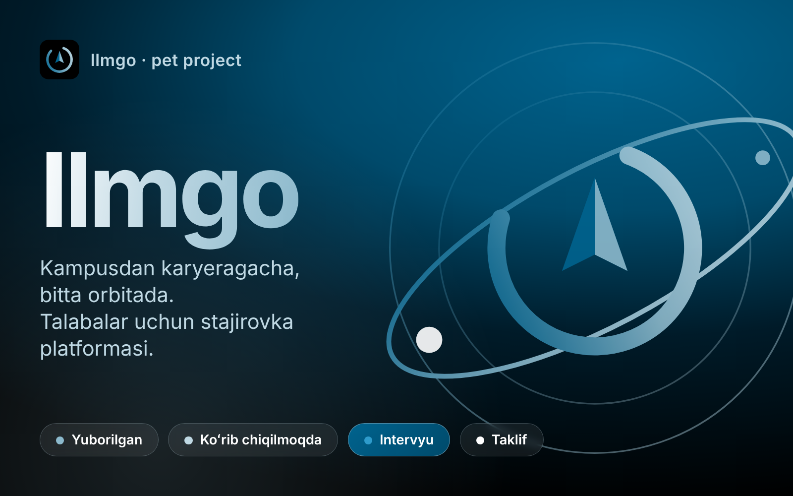
</p>

<h1 align="center">Ilmgo</h1>

<p align="center">
  <b>University internship & career platform</b><br>
  Flutter student app · React website & admin console · Node.js + PostgreSQL API<br>
  <sub>Product language: Uzbek · <i>Kampusdan karyeragacha, bitta orbitada.</i></sub>
</p>

<p align="center">
  
  
  
  
  
</p>

> Ilmgo grew out of my earlier project, [Career Services Portal](https://github.com/javohir-io/career-services-portal), rebuilt with a new design system, an Uzbek UI, a React website and admin console, and a redesigned API.

## Overview

Students discover internships that match their skills, apply with a résumé, track every application and book interviews. Career-services admins run the whole pipeline from a web console.

## Features

**For students (mobile app)**
- Job discovery with search and filters, and saved jobs
- **Match score** on every job: which of your skills match and which are missing
- Application form with résumé upload
- **Application pipeline**: Yuborilgan → Koʻrib chiqilmoqda → Intervyu → Taklif, with a timeline of every status change
- **Interview booking** with 30-minute weekday slots and `.ics` calendar export
- In-app notifications inbox, profile with completeness hints

**For admins (web console at `/admin`)**
- Overview with charts (applications per day, by status, top jobs, upcoming interviews)
- Jobs CRUD with cover images
- **Drag-and-drop kanban** for applications; every move notifies the student
- Interview calendar, student list, CSV export

**Website**
- Motion-rich landing page (GSAP scroll choreography, 3D hero, shader-gradient background), public job board and job pages
- Reduced-motion support, skeleton / empty / error states everywhere

## Screenshots

### Mobile app

| Discover | Job detail | Apply |
|:--:|:--:|:--:|
| 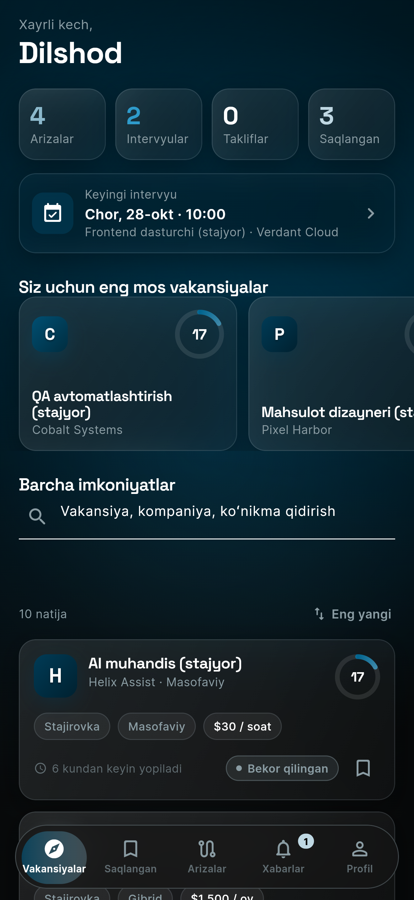 | 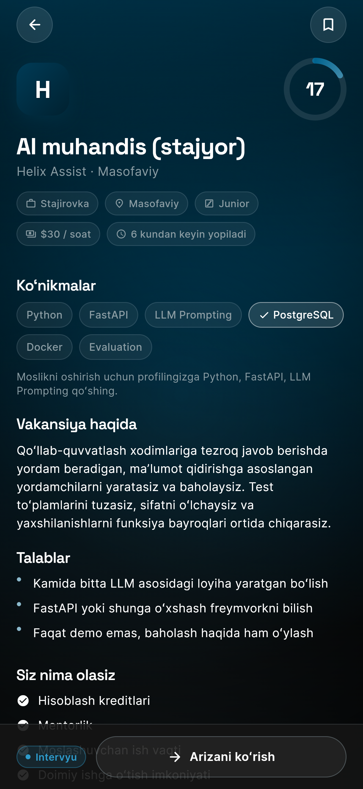 | 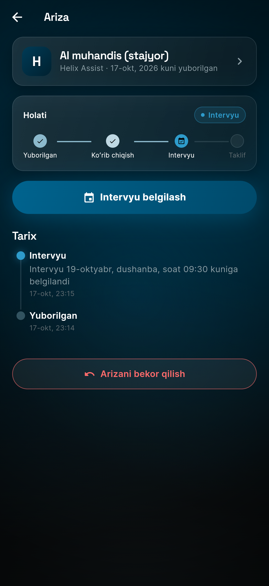 |

| Pipeline | Schedule interview | Inbox |
|:--:|:--:|:--:|
| 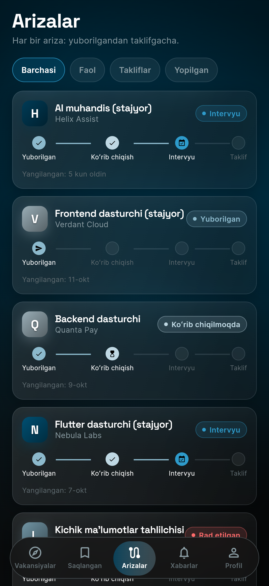 | 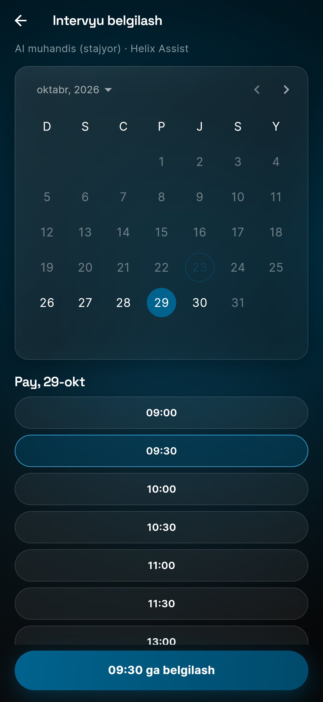 | 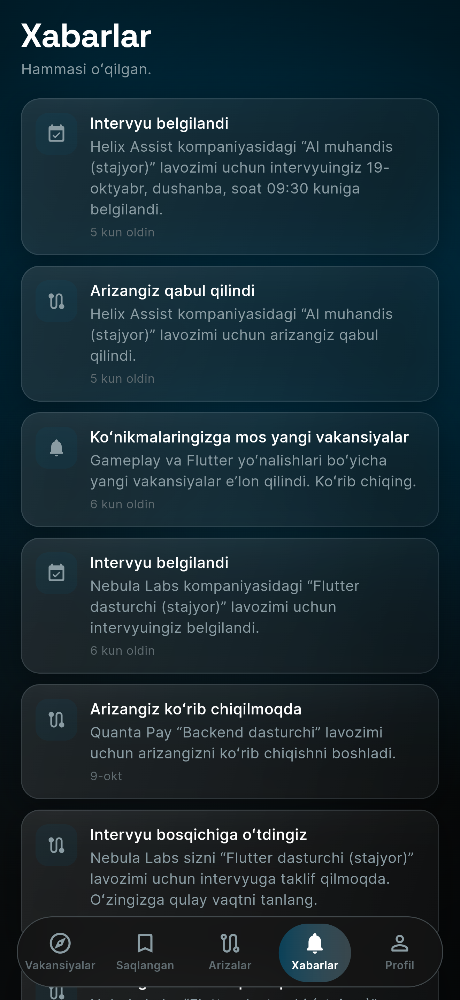 |

### Website

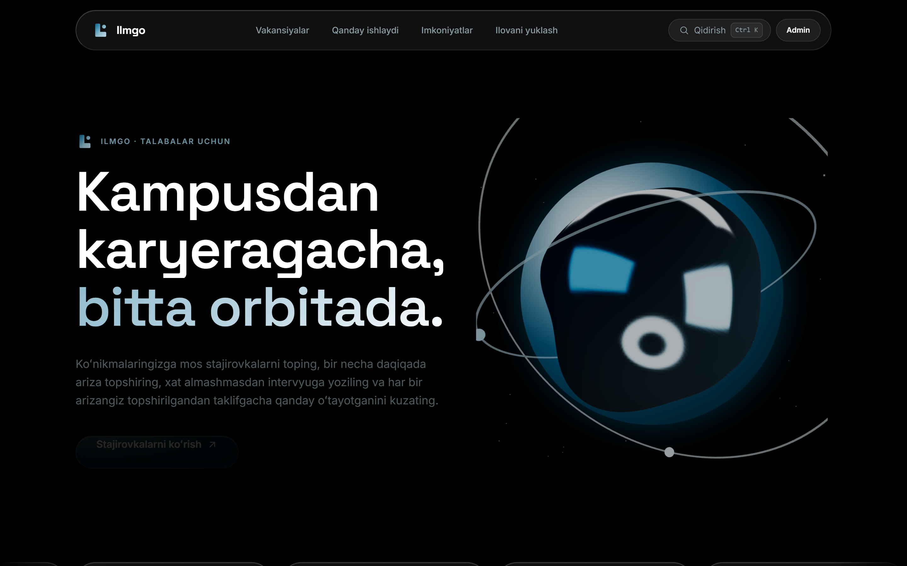

| Jobs | Job detail |
|:--:|:--:|
| 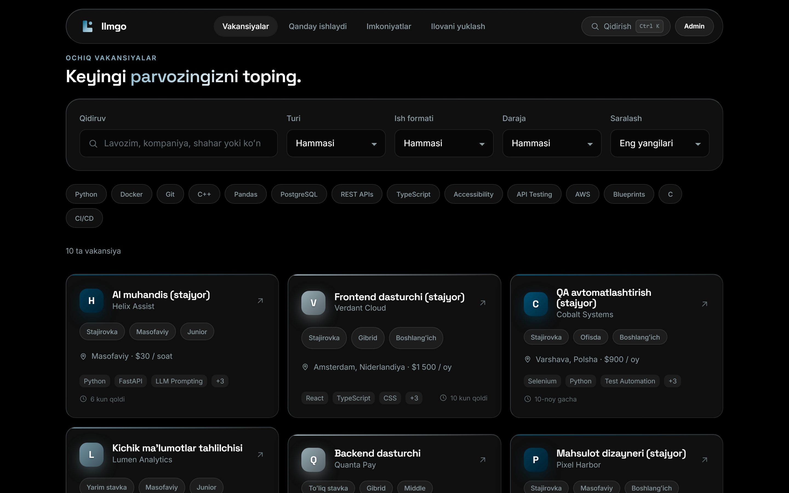 | 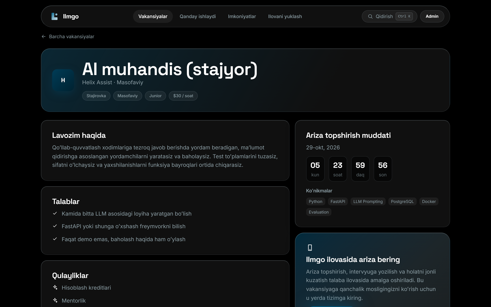 |

### Admin console

| Overview | Applications kanban |
|:--:|:--:|
| 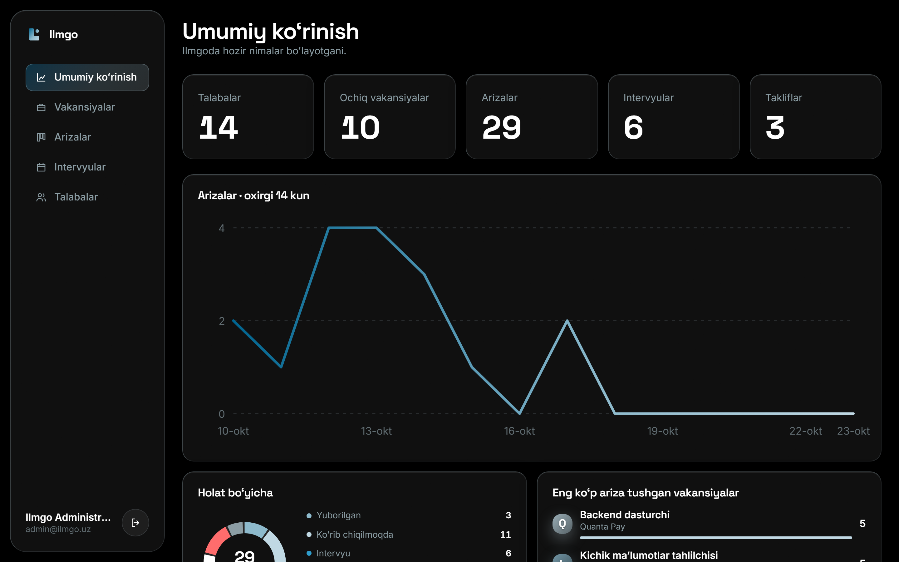 | 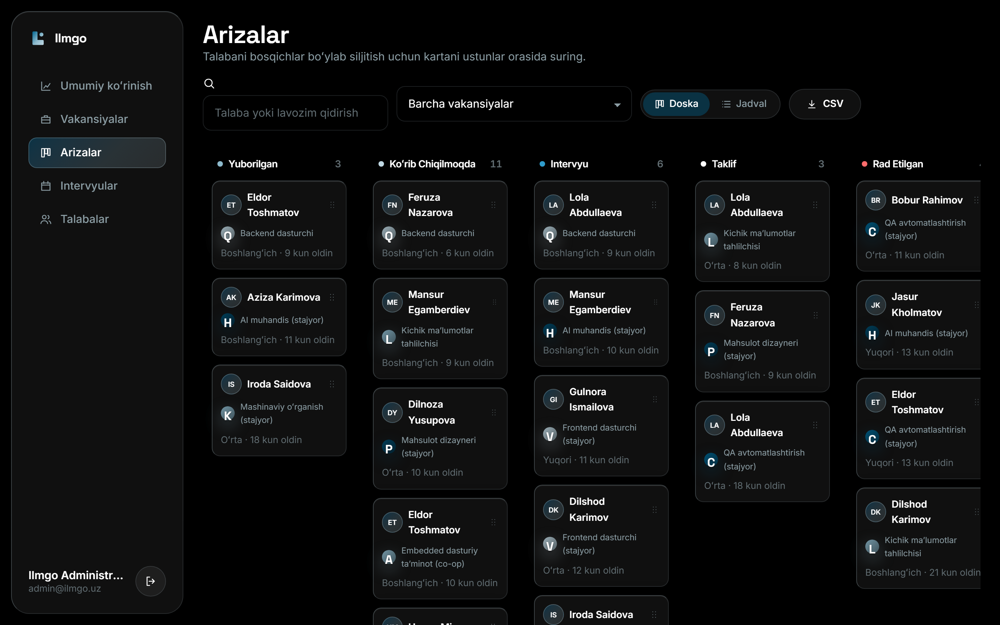 |

## Architecture

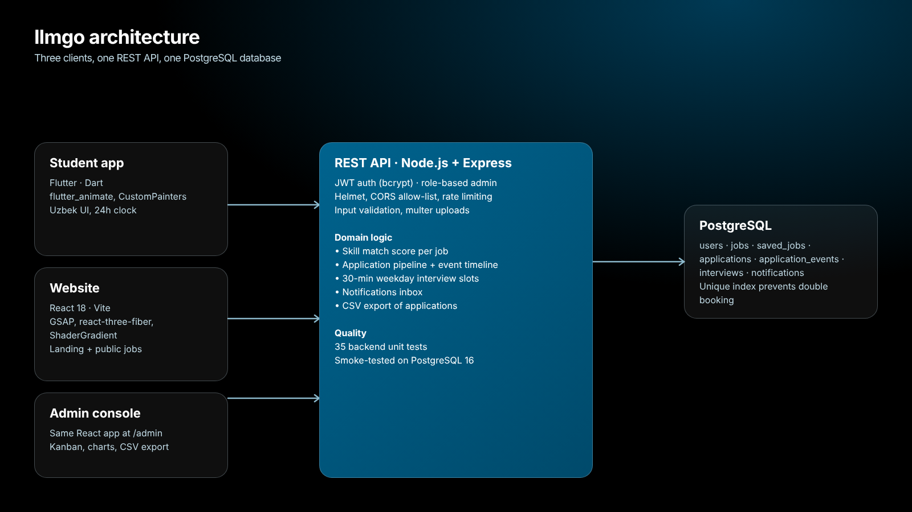

| Part | Folder | Stack |
|---|---|---|
| Student mobile app | [`app/`](app) | Flutter, Dart, `flutter_animate`, CustomPainter |
| Website + admin console | [`web/`](web) | React 18, Vite, GSAP, react-three-fiber, ShaderGradient |
| API | [`backend/`](backend) | Node.js, Express, PostgreSQL 16, JWT |
| Docs | [`docs/`](docs) | [`API.md`](docs/API.md), [`DESIGN.md`](docs/DESIGN.md) |

**Notable decisions**
- **No double booking.** A unique constraint in PostgreSQL enforces slot uniqueness; the client reloads free slots on a `409`.
- **Pipeline as an event log.** Every status change is a row in `application_events`; student and admin timelines read the same data.
- **One design system, two clients.** The same palette and tokens live in CSS custom properties and in the Flutter theme.
- **Stable API contract, localised clients.** Enum values stay English; each client maps them to Uzbek labels.
- **Security basics:** bcrypt, JWT, Helmet, CORS allow-list, rate limiting, input validation, upload limits, tokens redacted from logs.

## Design

Palette: **Dark Azure** `#00638E`, **Light Azure** `#BFD8E3`, **Onyx** `#000000` / `#141414`, **Charcoal** `#2B2B2B`, **Paper White** `#FFFFFF`, with the branding gradient `#000000 → #004A6B → #00638E → #8CB9CC`. Fonts: Space Grotesk and Inter. Details in [`docs/DESIGN.md`](docs/DESIGN.md).

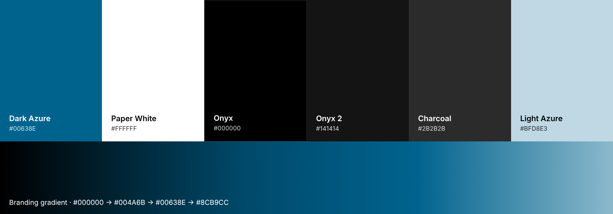

## Getting started

**Requirements:** Node.js 18+, Docker Desktop (for PostgreSQL), Flutter SDK.

```bash
# 1. API + database
cd backend
npm install
cp .env.example .env              # Windows: copy .env.example .env, then set JWT_SECRET
docker compose up -d              # PostgreSQL 16
npm run migrate && npm run seed:demo
npm run dev                       # http://localhost:3000

# 2. Website + admin (new terminal)
cd web
npm install
npm run dev                       # http://localhost:5173, admin at /admin

# 3. Mobile app (new terminal)
cd app
flutter create . --platforms=android,ios,web   # only if android/ios folders are missing
flutter pub get
flutter run --dart-define=API_BASE_URL=http://10.0.2.2:3000   # Android emulator
```

For `API_BASE_URL` use `http://10.0.2.2:3000` on the Android emulator, `http://localhost:3000` in Chrome or the iOS simulator, and your computer's LAN IP on a real phone.
Generate a secret for `JWT_SECRET` with:
`node -e "console.log(require('crypto').randomBytes(48).toString('hex'))"`

**Demo accounts (development only, change them in any real deployment)**

| Role | Email | Password |
|---|---|---|
| Student | `demo@ilmgo.uz` | `Demo1234!` |
| Admin | `admin@ilmgo.uz` | `Admin123!` |

Seed data uses fictional companies and students.

## Tests

```bash
cd backend && npm test      # 35 unit tests (node:test)
```

## Status

| Part | State |
|---|---|
| `backend/` | 35 unit tests; exercised against PostgreSQL 16 |
| `web/`, `app/` | Developed and tried manually against the API; no automated UI tests yet |
| Deployment | Not deployed; no email or push notifications yet |

**Roadmap:** deployment (hosted PostgreSQL + static web), push notifications, email, password reset, automated UI tests.

## License

[MIT](LICENSE) © 2026 Javohir Abduvahhobov
